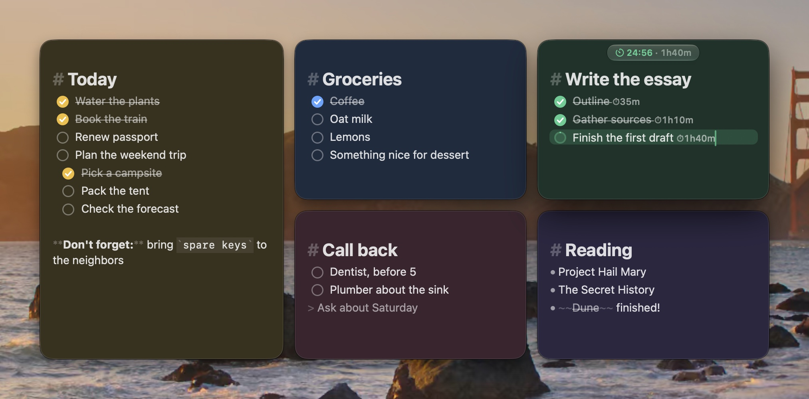
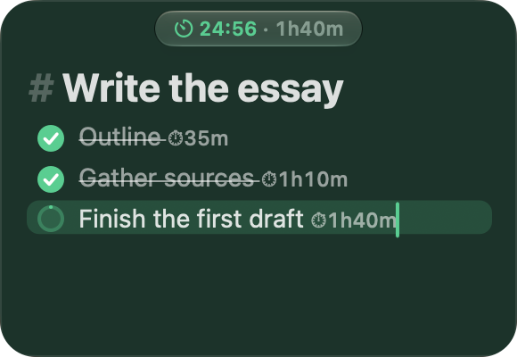
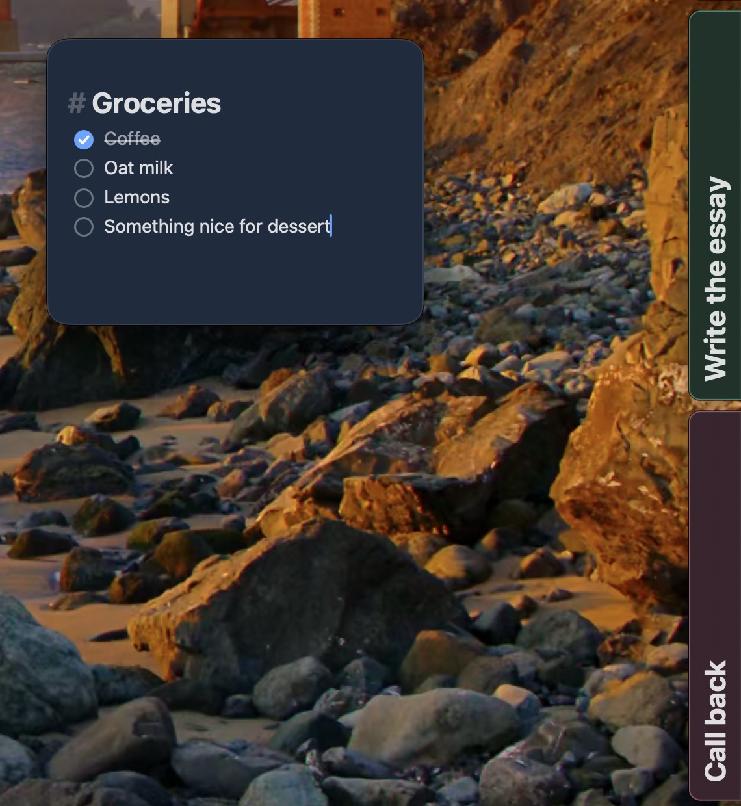
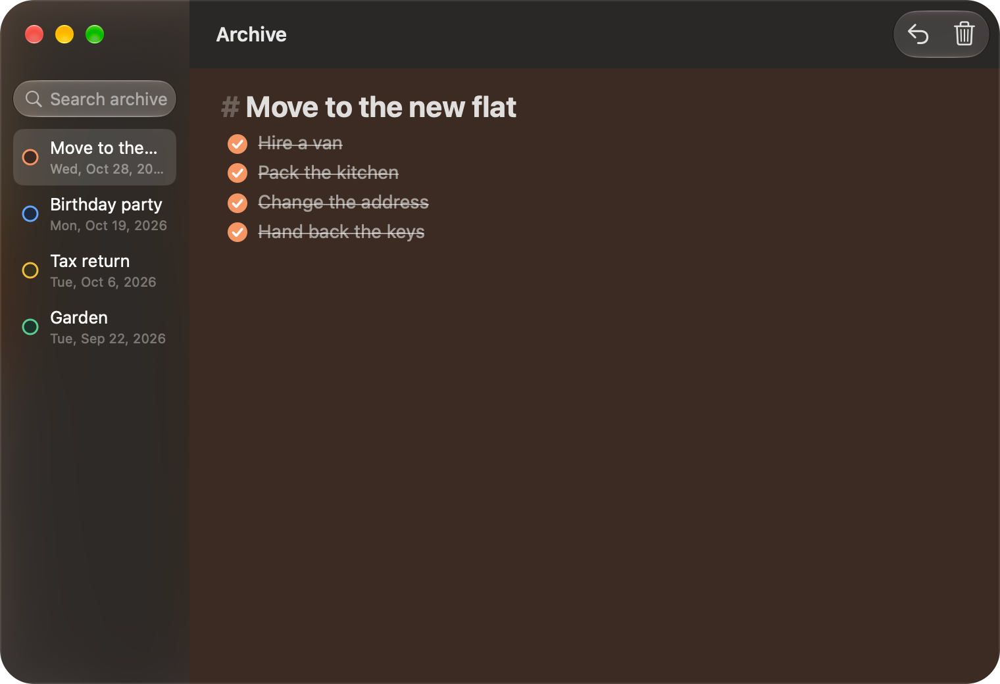

<p align="center">
  <picture>
    <source media="(prefers-color-scheme: dark)" srcset="docs/images/logo-dark.png">
    
  </picture>
</p>

<p align="center"></p>

<h3 align="center">Small sticky notes for macOS</h3>

<p align="center">For macOS 14 and later · Native Swift and AppKit · No accounts, no cloud</p>

Stackies keeps a handful of colorful notes floating on your desktop. Type, and your text, position, size and
color are saved. Write `- [ ]` and you have a checklist. Press ⌘T on an item and you have a focus timer. When a
note is done, tuck it to the screen edge or file it in the archive.

## Features

**Markdown as you type.** Headings, bold, italic, links, lists and quotes are styled live, and `- [ ]` items get
clickable checkboxes.

**Focus timers.** Start a pomodoro on any checklist item. The countdown shows in the note and the menu bar, and
each item keeps a total of the time you've spent on it.



**Tuck, archive, reopen.** Slide a note to the screen edge as a small tab (⌘J), file finished notes in a searchable
archive (⌃⌘A), or bring back a closed note (⇧⌘T).





**Local and private.** Everything lives in one JSON file on your Mac, at
`~/Library/Application Support/Stackies/notes.json`.

## Install

There's no download yet, so build it from source. You need macOS 14 or later and Xcode or the Swift toolchain.

```sh
git clone https://github.com/kylepollina/stackies.git
cd stackies
./scripts/build.sh --install   # builds Stackies and installs it to /Applications
open /Applications/Stackies.app
```

To build without installing, run `./scripts/build.sh`, which creates `build/Stackies.app`. Build this way rather than
with `swift run` if you want the Liquid Glass look on macOS 26 and later.

## Known issues

Autocorrect doesn't work in notes yet, and emoji have been reported not to insert. Details and other ideas are in
[IDEAS.md](IDEAS.md).

The landing page lives in [`docs/`](docs/).

## License

[MIT](LICENSE). The bundled sounds are CC0 recordings, trimmed for use as alerts:

- Deep Bowl: [Singing Bowl - Soft Stick Meditative Hit](https://freesound.org/people/Rimych/sounds/616335/) by Rimych
- Low Bowl: [Singing bowl, low and quiet](https://freesound.org/people/eliasheuninck/sounds/170672/) by eliasheuninck
- Soft Bowl: [singing bowl - single strike 6](https://freesound.org/people/s-light/sounds/415141/) by s-light
- Brass Bowl: [ChaliceChime](https://freesound.org/people/ChaliceAV/sounds/509926/) by ChaliceAV
- Singing Bowl: [Tibetan bowl struck #3](https://bigsoundbank.com/sound-2554-bol-tibetain-frappe-3.html) by Joseph Sardin (BigSoundBank)
