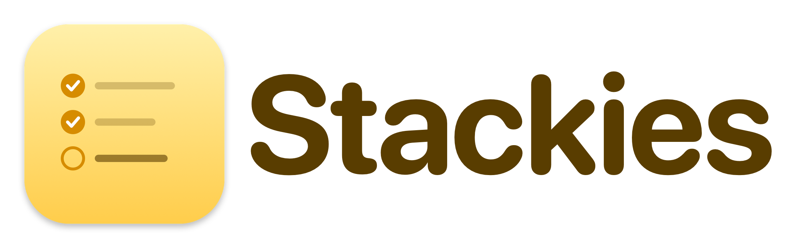

<p align="center">
  <picture>
    <source media="(prefers-color-scheme: dark)" srcset="docs/images/logo-dark.png">
    
  </picture>
</p>

<p align="center">
  <strong>Small, modern sticky notes for macOS: quick scratchpads for todos and short-lived reminders.</strong>
</p>

<p align="center">
  Native Swift/AppKit · Markdown-styled as you type · Checklists with pomodoro timers · No accounts, no cloud
</p>

<!-- TODO(Kyle): screenshots. Add docs/images/hero.png (a few colorful notes on the desktop),
     then replace this comment with:  
     See "Screenshots" below for the full shot list. -->

Stackies keeps a handful of colorful notes floating on your desktop. Type, and everything is
saved: text, position, size and color. Write `- [ ]` and you have a checklist; press ⌘T on an item and
you have a focus timer. When a note is done, tuck it to the screen edge or file it in the archive.

## Features

- **Autosave.** No save button. Notes reopen exactly as you left them.
- **Live markdown styling.** Headings, **bold**, _italic_, ~~strikethrough~~, `inline code`, links,
  bullet and numbered lists, and quotes are styled as you type.
- **Checklists.** `- [ ]` items get clickable checkboxes. Nest subtasks, reorder items with their
  subtasks (⌘↑ / ⌘↓), and paste lists from other apps (`•`, `☐`, `✓` lists become checkboxes).
- **Seven note colors**, with light and dark variants. Pin a note to **keep it on top**.
- **Pomodoro timers on checklist items.** Start one at the caret (⌘T); the countdown shows in the note
  and in the menu bar, where you can pause, stop, or jump to the task. Total focus time is tracked per
  item as a `⏱1h40m` tag, and turns orange (with a one-time alert) once it passes a limit you set.
  Recorded singing-bowl chimes or any system sound mark the end of a focus session or break.
- **Tuck away.** Slide a note to the screen edge as a small tab (⌘J); click the tab to bring it back.
  Tabs can be dragged along the edge and between displays. Tuck every note at once with ⇧⌘J.
- **Archive.** File away finished notes (⌃⌘A) and browse them later (⌥⌘A): newest first, searchable,
  previewed in their original color, restorable or deletable.
- **Reopen closed notes.** Closed or deleted notes can be brought back with ⇧⌘T (until you quit).
- **Stage Manager friendly.** All of your notes share one stage; pinned notes stay visible across stages.
- **Spell checking.** Misspelled words get red underlines. (Autocorrect is not working yet; see
  [Known issues](#known-issues).)
- **Local and private.** Everything lives in one JSON file on your Mac.

## Screenshots

<!-- TODO(Kyle): screenshots could not be captured automatically (the tool that wrote this README had
     no Screen Recording permission). Suggested shots, saved into docs/images/ at 2x:
       hero.png       a few notes in different colors on the desktop
       checklist.png  a checklist with a running pomodoro and a ⏱ tag
       menubar.png    the menu bar timer with its menu open
       archive.png    the archive window (⌥⌘A) with a note previewed
       tucked.png     a tucked tab at the screen edge
       settings.png   the Settings window (⌘,)
     Then uncomment the table below. Use sample content only. -->

_Screenshots coming soon._

<!--
| | |
|---|---|
|  |  |
|  |  |
|  |  |
-->

## Install

### Build from source

**Requirements:** macOS 14 (Sonoma) or later, and Xcode or the Swift toolchain (the package uses
`swift-tools-version:5.10`). The app is built with the current macOS SDK so it gets the modern system
look (Liquid Glass) on macOS 26 and later.

```sh
git clone <repository-url> stackies   # TODO(Kyle): fill in the repository URL
cd stackies
./scripts/build.sh --install
```

That builds `build/Stackies.app` and copies it to `/Applications`. Leave off `--install` to build
without copying:

```sh
./scripts/build.sh        # produces build/Stackies.app
open build/Stackies.app
```

The app is ad-hoc signed (no Apple Developer account needed). If you copy it to another Mac,
macOS Gatekeeper may ask you to right-click ▸ Open the first time.

### Download a prebuilt app

> **Placeholder.** No release has been published yet. TODO(Kyle): add a link to the latest
> [release](../../releases) here once a signed or notarized build exists.

## Using Stackies

Launch Stackies and press **⌘N** for a new note. Stackies has no main window: it lives in the Dock
(right-click the Dock icon for New Note and Show All Notes), and closing the last note doesn't quit it.

A taste of the markdown:

```markdown
# Today
- [ ] Review pull requests ⏱25m 🍅
  - [ ] Fix the **flaky** test
- [x] Write the README
> Small steps, done daily.
```

### Keyboard shortcuts

| Action | Shortcut |
|---|---|
| New note | ⌘N |
| Toggle checklist | ⌘L |
| Mark done | ⌘↩ |
| Bold / Italic / Strikethrough | ⌘B / ⌘I / ⇧⌘X |
| Move item (with subtasks) up / down | ⌘↑ / ⌘↓ |
| Keep on top | ⌘P |
| Tuck away to the screen edge (click the tab to bring it back) | ⌘J |
| Tuck all notes away / bring them all back | ⇧⌘J |
| Start or pause a pomodoro on the item at the caret | ⌘T |
| Note color | ⌘1–⌘7 (⌘0 for random) |
| Archive note | ⌃⌘A |
| Browse the archive (search, restore, delete) | ⌥⌘A |
| Show all notes | ⇧⌘A |
| Delete note (asks first) | ⇧⌘⌫ |
| Reopen last closed or deleted note | ⇧⌘T |
| Settings | ⌘, |

### Pomodoro settings

Open **Stackies ▸ Settings…** (⌘,) to set the focus length (default 25 min), break length (default
5 min), the time after which a task is flagged, and the sounds for end of focus and end of break.

### Where your notes live

Notes are stored in `~/Library/Application Support/Stackies/notes.json`. Back that file up or sync it
however you like. Pomodoro settings are kept in the app's preferences.

## Project structure

```
Package.swift            Swift package (macOS 14+, one executable target)
Sources/Stackies/
  StackiesApp.swift        app entry point
  AppDelegate.swift        menus, Dock menu, window management, Stage Manager handling
  NoteWindowController.swift  one window per note: color, pinning, titlebar
  NoteTextView.swift       text view: checkbox clicks, list continuation, smart paste, shortcuts
  Markdown.swift           live markdown parsing and styling
  TextKit.swift            custom text layout/drawing helpers
  Note.swift, NoteStore.swift  the note model and its JSON persistence
  Pomodoro.swift, PomodoroSound.swift, MenuBarTimer.swift  timers, sounds, menu bar item
  TuckTab.swift            edge tabs for tucked notes
  ArchiveView.swift        archive browser (SwiftUI)
  SettingsView.swift       Settings window (SwiftUI)
Resources/
  Info.plist               app bundle metadata
  Sounds/                  recorded singing-bowl chimes
scripts/
  build.sh                 builds, bundles, and ad-hoc signs build/Stackies.app
  make-icon.swift          generates the app icon
IDEAS.md                 ideas, decisions and known bugs
```

## Development

```sh
swift build               # debug build
swift run Stackies        # run the debug build directly
./scripts/build.sh        # full release bundle in build/
```

`scripts/build.sh` bundles the release binary, generates the icon on first run, copies the sounds,
and re-stamps the binary with the real SDK version (SwiftPM records only the deployment target, which
would otherwise put AppKit in compatibility mode with no Liquid Glass). It ends with an ad-hoc
`codesign`. There are no automated tests yet; run the app and try your change.

The README logo is generated by `swift scripts/make-logo.swift` (run from the repo root); it writes
`docs/images/logo-light.png` and `logo-dark.png`.

Open the folder in Xcode (File ▸ Open… on `Package.swift`) if you prefer an IDE.

## Known issues

- **Autocorrect doesn't work.** Misspelled words are underlined in red, but typing `teh ` does not
  become `the`. See the Bugs section of [IDEAS.md](IDEAS.md) for what has been tried.
- Stage Manager and multi-display handling rely on workarounds for AppKit window behavior and may
  misbehave on some setups; please report oddities.

## Roadmap

Not shipped, just ideas (full list in [IDEAS.md](IDEAS.md)): a Today view of every unchecked item,
offering to archive fully checked notes, due dates and reminders, a weekly time summary, focus mode,
quick search (⌘K), Markdown file export/sync, and Shortcuts actions.

## License

Stackies is released under the [MIT License](LICENSE). The bundled sounds have their own
licenses; see [Credits](#credits).

## Credits

Pomodoro sounds are CC0 recordings, trimmed for use as alerts:

- Deep Bowl: [Singing Bowl - Soft Stick Meditative Hit](https://freesound.org/people/Rimych/sounds/616335/) by Rimych
- Low Bowl: [Singing bowl, low and quiet](https://freesound.org/people/eliasheuninck/sounds/170672/) by eliasheuninck
- Soft Bowl: [singing bowl - single strike 6](https://freesound.org/people/s-light/sounds/415141/) by s-light
- Brass Bowl: [ChaliceChime](https://freesound.org/people/ChaliceAV/sounds/509926/) by ChaliceAV
- Singing Bowl: [Tibetan bowl struck #3](https://bigsoundbank.com/sound-2554-bol-tibetain-frappe-3.html) by Joseph Sardin (BigSoundBank)
